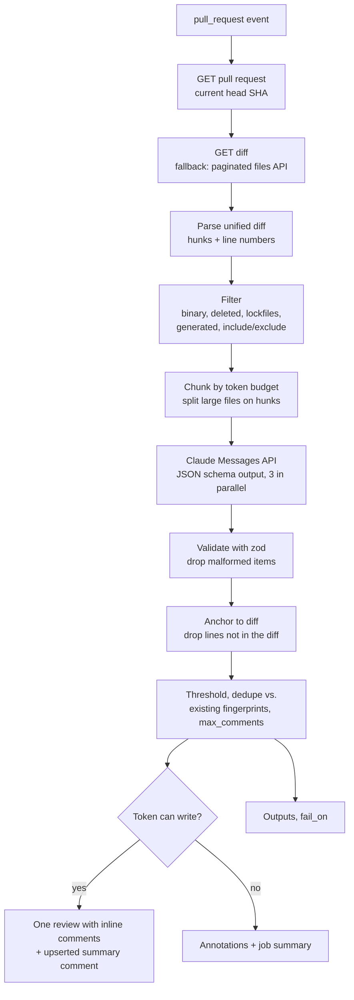

# ai-pr-reviewer

[](https://github.com/mayank-urnextdoor/ai-pr-reviewer/actions/workflows/ci.yml)
[](LICENSE)

A GitHub Action that reviews pull requests with Claude and posts the results as a normal GitHub review: inline comments on the changed lines, one-click suggestion blocks where the fix is concrete, and a single summary comment that is updated on each push.

## Why

Most "AI review" bots fail in the same few ways: comments on lines that are not in the diff (GitHub rejects them, or they land in the wrong place), the same comment reposted on every push, a wall of style nits, and no control over spend. This action is built around those problems:

- **Every finding is checked against the diff before posting.** The model sees the diff with head-side line numbers, returns structured JSON (enforced with the API's JSON-schema output and validated again with zod), and any finding whose line is not a commentable line in the diff is discarded. Multi-line ranges must stay inside one hunk.
- **Re-runs do not repeat themselves.** Each comment carries a hidden fingerprint based on the file, category and the code it points at (not the line number, which moves). Findings already on the PR are skipped, and the summary comment is edited in place.
- **Noise and cost are bounded.** `severity_threshold`, `max_comments`, `max_tokens_per_chunk` and `max_chunks` cap what gets posted and what gets sent. Lockfiles, generated, vendored and binary files are skipped by default.
- **Untrusted code is never executed.** The action reads the diff through the API; it needs no checkout.

## Usage

Add an `ANTHROPIC_API_KEY` repository secret, then create `.github/workflows/review.yml`:

```yaml
name: AI review
on:
  pull_request:
    types: [opened, synchronize, reopened, ready_for_review]

concurrency:
  group: ai-review-${{ github.event.pull_request.number }}
  cancel-in-progress: true

permissions:
  contents: read
  pull-requests: write

jobs:
  review:
    runs-on: ubuntu-latest
    if: github.event.pull_request.head.repo.full_name == github.repository
    steps:
      - uses: mayank-urnextdoor/ai-pr-reviewer@v1
        with:
          anthropic_api_key: ${{ secrets.ANTHROPIC_API_KEY }}
```

A fuller example is in [`examples/review.yml`](examples/review.yml).

### Inputs

| Input | Default | Description |
| --- | --- | --- |
| `anthropic_api_key` | | Anthropic API key, from a secret. If empty (for example on fork PRs) the action warns and exits successfully. |
| `github_token` | `${{ github.token }}` | Token for reading the PR and posting. Needs `pull-requests: write` to post. |
| `model` | `claude-sonnet-5-5` | Claude model ID. |
| `include` | | Globs (newline or comma separated). If set, only matching files are reviewed. |
| `exclude` | | Globs of files to skip. Applied after `include`. |
| `skip_generated` | `true` | Skip lockfiles and generated or vendored files (by path, and by markers such as `@generated` or `Code generated ... DO NOT EDIT` at the top of the file). |
| `max_comments` | `20` | Maximum new inline comments per run (0-100). Most severe first. |
| `severity_threshold` | `medium` | Minimum severity to post: `low`, `medium`, `high`, `critical`. |
| `fail_on` | `none` | Fail the step if any finding is at or above this severity. |
| `max_tokens_per_chunk` | `30000` | Estimated diff tokens per request. Larger diffs are split. |
| `max_chunks` | `10` | Maximum requests per run. Files beyond this are listed as not reviewed. |
| `max_output_tokens` | `16000` | `max_tokens` per request (includes the model's thinking). |
| `effort` | | Optional `low` / `medium` / `high` / `xhigh` / `max`. Empty uses the model's default. |
| `refusal_fallback` | `true` | If the model declines a request, let the API retry it on a fallback model (server-side fallbacks, beta). Disabled automatically for models that reject the parameter. |
| `review_instructions` | | Extra guidance appended to the system prompt, such as project conventions. |
| `skip_drafts` | `true` | Do not review draft PRs. |
| `dry_run` | `false` | Review and write the job summary, but post nothing to the PR. |

### Outputs

| Output | Description |
| --- | --- |
| `findings_count` | Valid findings anchored to the diff, including ones already posted on earlier runs. |
| `comments_posted` | New inline comments posted in this run. |
| `highest_severity` | Highest severity found, or `none`. |
| `review_id` | ID of the review created in this run, or empty. |
| `model` | The requested model. |

## How it works



Some details:

- **Diff parsing** ([`src/diff.ts`](src/diff.ts)) counts lines from each `@@` header instead of pattern matching, so a removed line whose text starts with `--` is not mistaken for a file header. It handles renames, copies, mode changes, binary markers, quoted paths and `\ No newline at end of file`.
- **Line mapping** ([`src/linemap.ts`](src/linemap.ts)) indexes the head-side (`RIGHT`) lines of every hunk. A suggestion is only attached when its whole range is inside one hunk; otherwise the comment becomes single-line and the suggestion is dropped, because it was written for a different range.
- **Chunking** ([`src/chunk.ts`](src/chunk.ts)) estimates tokens locally at 3 characters per token (deliberately pessimistic for code). A single hunk bigger than the budget is skipped and reported in the summary rather than truncated.
- **Model output** ([`src/reviewer.ts`](src/reviewer.ts)) uses `output_config.format` with a JSON schema. Refusals and `max_tokens` cut-offs are reported per chunk; one failed chunk does not abort the others.
- **Formatting** ([`src/format.ts`](src/format.ts)) neutralizes `@mentions` and HTML comments in model text, so a prompt-injected diff cannot ping people or spoof the dedupe markers. Suggestion fences are lengthened when the code contains backticks.

## Security

**Use `pull_request`, not `pull_request_target`.**

- With `pull_request`, a PR from a fork runs with a read-only token and **no secrets**. The action sees an empty API key and exits with a warning, so nothing is spent and nothing leaks. The example workflow skips fork PRs explicitly.
- `pull_request_target` runs in the context of the base repository, with secrets and a write token, even for PRs from forks. It is safe only as long as nothing from the PR is executed. This action does not check out or run PR code, but a workflow that adds `actions/checkout` with `ref: ${{ github.event.pull_request.head.sha }}` and then runs a build, tests or package install would hand your secrets to whoever opened the PR. The action logs a warning when it runs under `pull_request_target`. If you need reviews on fork PRs, prefer having a maintainer trigger them (for example a label-gated job) over running automatically for anyone.
- **Prompt injection.** The diff and PR description are written by the PR author and can contain instructions aimed at the model. The system prompt tells the model to treat them as untrusted, but that is a mitigation, not a guarantee. The design limits what injected text can do: the model has no tools, its only output is review comments, every comment is anchored to real diff lines, mentions and HTML comments are neutralized, and the review is posted as `COMMENT` (never `APPROVE`). Do not use this action's output as a merge gate on its own; `fail_on` can block a merge but cannot approve one.
- **API key handling.** The key is registered with `core.setSecret` before anything is logged, so the runner masks it. It is only sent to the Anthropic API.
- **Permissions.** Grant `contents: read` and `pull-requests: write` and nothing else. With only read access, findings are reported as workflow annotations and in the job summary.
- **Data.** The diff of reviewed files and the PR title/description are sent to Anthropic's API. Use `exclude` for files that must not leave GitHub, and check that this is acceptable for your repository.

## Cost control

Each run makes at most `max_chunks` requests of at most about `max_tokens_per_chunk` diff tokens, plus a system prompt of under 1k tokens. Each response is capped by `max_output_tokens` (thinking included). The summary comment reports the exact input and output tokens used.

As a rough guide (check [current pricing](https://platform.claude.com/docs/en/about-claude/pricing) for the model you choose):

- A typical PR with a few hundred changed lines is one request of a few thousand input tokens and a few thousand output tokens.
- The defaults cap input at roughly 300k tokens per run, plus output capped by `max_output_tokens` per request.

To spend less: narrow `include`, add `exclude` patterns, lower `max_chunks`, set `effort: low`, skip drafts (default), and use the `concurrency` block from the example so superseded pushes are cancelled.

## Limitations

- The model only sees the diff, not the rest of the repository. It cannot know that a function called in the diff already validates its input elsewhere, so some findings will be wrong. Treat comments as review suggestions, not verdicts.
- Comments can only be placed on head-side lines in the diff. Problems in deleted code or in unchanged code outside the hunks are mentioned in the summary at best.
- Token counts are estimated locally, not with the token-counting API, so chunk sizes are approximate (on the conservative side).
- When GitHub refuses the full diff as too large, the files endpoint is used; it returns at most 3000 files and omits patches for very large files, which are then treated like binary files and skipped.
- Dedupe is keyed on the code a comment points at. If that code changes, a still-relevant finding may be posted again; if the model files the same problem under a different category, it can also be posted twice.
- Fork PRs are not reviewed under `pull_request`, by design (see Security).
- Behavior against a live PR (comment placement, suggestion rendering, permission fallbacks) is covered by mocked tests here; GitHub's API is the final judge.

## Roadmap

- Optional repository context: fetch the full content of changed files (within budget) so the model sees code around the hunks.
- Prompt caching for the shared prefix when a large repository context is included.
- Resolve or mark outdated the bot's earlier comments whose code has since changed.
- Count tokens with the API's token-counting endpoint instead of estimating.
- A `workflow_dispatch` / label-triggered mode for reviewing fork PRs safely.
- Per-path instructions (for example stricter rules for `migrations/**`).

## Development

```sh
npm ci
npm run typecheck
npm run lint
npm test
npm run build   # writes dist/index.js; commit it with your change
```

Tests run offline: Octokit and the Anthropic client are stubbed. See [CONTRIBUTING.md](CONTRIBUTING.md).

## License

[MIT](LICENSE)
